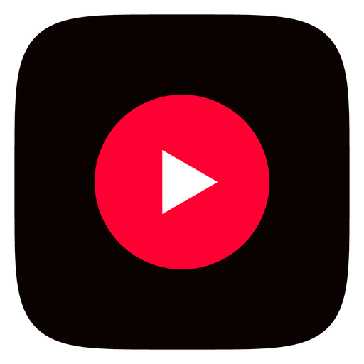

# NewTube+

### A fork of NewTube with a glassier, livelier player and feed.

**NewTube+** is a fork of [NewTube](https://github.com/aleixrodriala/newtube) by
[@aleixrodriala](https://github.com/aleixrodriala), the phone-only YouTube client built on
[SmartTube](https://github.com/yuliskov/SmartTube) by [@yuliskov](https://github.com/yuliskov). 
It keeps everything NewTube does and changes how the app looks, moves and previews videos.

**[Download](#download) · [What's different](#whats-different-from-newtube) · [Updates](#updates) · [Based on](#based-on)**

> [!NOTE]
> **NewTube+ is an independent fork, not NewTube.** It installs as its own app next to NewTube
> and takes its updates only from this repository. The YouTube engine, sign-in, SponsorBlock,
> DeArrow and the rest come from NewTube and [SmartTube](https://github.com/yuliskov/SmartTube);
> see [Based on](#based-on).

## What's different from NewTube

### Look and feel

- **Frosted-glass bars.** The top bar, bottom navigation and mini-player blur what is behind them
  live, as it scrolls and as tabs slide past.
- **Accent colour everywhere.** Pick an accent and the progress bars, play logo and "+" take it as
  a gradient; the mini-player and seek bars match, with a solid scrubber dot.
- **Tab slide with memory.** Swipe between tabs and the page slides with you. Each tab keeps its
  scroll position and its thumbnails, tapping the tab you are on scrolls to the top, and tapping
  again at the top refreshes.
- **Playlists in two columns**, with loading placeholders that match.
- **New app icon and splash:** a red play circle, and a splash in your accent colour.
- **Ambient glow and vignette** around the player that follow the picture, in light and dark.

### Player

- **Wave progress bar.** A One UI-style waving seek bar for music, with its own options under
  Settings → Playback: waves for music and for other videos, wave humps, and where the colour comes
  from (accent, the video, or the thumbnail). Mark any video as a song from its gear menu.
- **Black-bar detection and crop.** Letterboxing and pillarboxing baked into a video are cropped
  and the player fits what is left, in the player, fullscreen and the mini-player. It looks only
  during the first 2.5 seconds, can be turned off, and *Detect black bars* / *Undo crop* are in the
  player's gear menu.
- **Player box in the video's own shape**, with a smoother mini-player glide and landing.

### Feed

- **Autoplay previews.** In a one-column feed the video at the reading line plays muted under its
  card, with a speaker toggle and a seek line you can drag. Settings → Playback → Feed autoplay turns
  it off, or limits it to Wi-Fi (the default).
- **Settings opens with a spinner** while the page builds, instead of a blank screen.

## Download

| Your device | File |
|:--|:--|
| Almost every phone from the last ~8 years | `NewTube_<version>_arm64-v8a.apk` |
| Older 32-bit phones | `NewTube_<version>_armeabi-v7a.apk` |
| Not sure (any ARM phone) | `NewTube_<version>_universal.apk` (bigger) |
| Older x86 devices and emulators | `NewTube_<version>_x86.apk` |

- **Requires Android 7.0 or newer.** Allow "Install unknown apps" when Android asks. NewTube+ has
  its own package name (`io.github.steeben.newtube`), so it installs next to NewTube, SmartTube and
  the YouTube app.
- **Coming from 1.0?** 1.0 was a test build with a one-off signing key, so uninstall it first and
  install 1.0.1 or newer. From 1.0.1 on, updates install over the app.
- **Verify what you install.** Releases are built by GitHub Actions from this repository and signed
  with one key. Its certificate SHA-256 is
  `69:6f:ba:66:e8:07:e6:bc:a5:ca:ea:e2:25:1f:25:ad:19:16:ca:01:e0:32:ec:28:6f:72:ba:42:be:8d:72:f5`.
  Check it with `apksigner verify --print-certs <file>.apk`.
  This key is not NewTube's, so neither app can update the other.
- **Distributed on GitHub**, not on Google Play.

## Updates

NewTube+ checks **this repository's** latest release (Settings → About → Check for updates, or the
dot on the You tab) and installs the update over the app. It never looks at the original NewTube's
releases.

## Based on

NewTube+ is built on other people's work:

| Project | By | Used for |
|:--|:--|:--|
| [NewTube](https://github.com/aleixrodriala/newtube) | [@aleixrodriala](https://github.com/aleixrodriala) | The phone app this is forked from: touch interface, player, offline saving, settings |
| [SmartTube](https://github.com/yuliskov/SmartTube) | [@yuliskov](https://github.com/yuliskov) and contributors | The engine, accounts and integrations: everything under the hood |
| [SponsorBlock](https://sponsor.ajay.app) · [DeArrow](https://dearrow.ajay.app) | Ajay Ramachandran and contributors | Segment and title data (CC BY-NC-SA 4.0) |
| [Return YouTube Dislike](https://returnyoutubedislike.com) | RYD contributors | Dislike counts |
| [androidx Media3](https://developer.android.com/media/media3) | Google (Apache-2.0) | Playback |

Inside the app, **Settings → About → Based on NewTube by aleixrodriala** lists the original
project's links. Everything NewTube does that is not listed above (account sign-in with a code,
background playback, offline saving, SponsorBlock, DeArrow, subtitles, gestures and the rest) works
as it does there; see [NewTube's README](https://github.com/aleixrodriala/newtube#readme) for the
full list. Full notices are in [THIRD_PARTY_NOTICES.md](THIRD_PARTY_NOTICES.md).

## About this fork

NewTube+ was built with AI coding assistance (Claude); each change was tried on a real phone by its
owner before release. It has no analytics, crash reporting or ad SDKs, like NewTube. Build
instructions are in [docs/BUILDING.md](docs/BUILDING.md), and the [changelog](CHANGELOG.md) lists
each release (entries before 1.0.1 are NewTube's).

## License

[MIT](LICENSE), the same as NewTube and SmartTube. © yuliskov (SmartTube), aleixrodriala (NewTube)
and NewTube+ contributors.

---

*NewTube+ is an independent, unofficial project. It is not affiliated with, funded, authorized or
endorsed by Google LLC, YouTube, NewTube's developer, or SmartTube's developer, and it hosts no
content. Save only what the law and the platform's terms allow you to. YouTube, Android and Google
are trademarks of Google LLC.*
